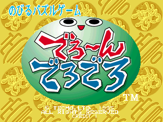
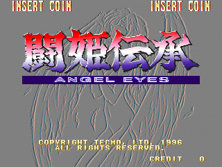
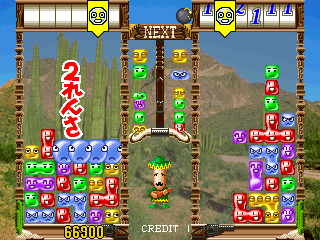
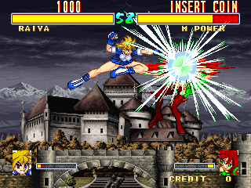
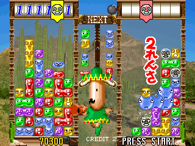
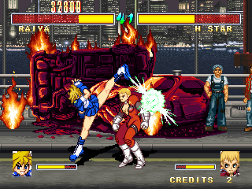

# Tecmo System for MiSTer

MAME's `tecmo/tecmosys.cpp` driver, Tecmo's 1995-1996 Tecmo System board (68000 at 16 MHz; a Z80 sound board at 8 MHz with a
YMF262 (OPL3), a YMZ280B and an OKI M6295; three 32 x 32 tilemaps of 16 x 16 tiles and a 64 x 64 text layer, up to 1024 zooming
8 bpp sprites a frame, two palettes with a blend flag; a 93C46 EEPROM for the settings and a 68HC11 protection MCU), for the
MiSTer FPGA platform:

| Game | Sets | MRA |
|---|---|---|
| Deroon DeroDero (1995) | `deroon` (earlier, set 1), `deroona` (earlier, set 2), `deroon2` (Tecmo Stackers) | `mra/Deroon DeroDero (earlier, set 1).mra`, the others in `mra/_alternatives/_Deroon DeroDero (earlier, set 1)/` |
| Toukidenshou - Angel Eyes (1996) | `tkdensho` (VER. 960614), `tkdenshoa` (VER. 960427) | `mra/Toukidenshou - Angel Eyes (VER. 960614).mra`, the other in `mra/_alternatives/_Toukidenshou - Angel Eyes (VER. 960614)/` |

**Requires an SDRAM module of 64 MB or more**: Angel Eyes has 30 MB of sprite ROM alone.

Written for MiSTer from MAME 0.289's driver (`tecmosys.cpp`, `tecmosys_v.cpp`, `tecmosys_m.cpp`) on the owner's Jackie Chan core
(the platform layer: SDRAM controller for the 64 MB module, loader, program caches, fast load, NVRAM save, Scale; and its YMZ280B),
with the sound board's structure after the owner's Super Duck core and the EEPROM from the Metro core (`rtl/UPSTREAM.md`). The 68000
is [fx68k](https://github.com/ijor/fx68k) (Jorge Cwik), the Z80 [TV80](https://github.com/hoglet67/tv80) (Guy Hutchison), the YMF262
[opl3_fpga](https://github.com/gtaylormb/opl3_fpga) (Greg Taylor, MiSTer's ao486 core's copy), the OKI M6295
[jt6295](https://github.com/jotego/jt6295) (Jose Tejada), the CRT Adjust page rmonic79's
[MiSTer-CRT-Adjust](https://github.com/rmonic79/MiSTer-CRT-Adjust) (`modules/VENDOR.md`). No ROMs are in this repository (the pictures
below are MAME screenshots); you supply your own MAME romset.

| Deroon DeroDero | Toukidenshou - Angel Eyes |
|---|---|
|  |  |
|  |  |
|  |  |

The pictures are MAME 0.289's (`tools/capture.py --play`). Deroon: the title once a coin is in, then a one-player game against the
first stage's opponent, first the player's two-chain and then the opponent's. Angel Eyes: the title in attract mode, then a flying
kick over the first stage's castle and a kick by the second stage's burning wreck. The core's video, given the same machine state,
draws each of the four game pictures identically to MAME (`tools/bench_video.py`).

## Status

**Tested on a real MiSTer** by the repository owner: both games run, with the buttons named per game; Start 1P+2P lets one player
leave Angel Eyes' I/O check; the sound checked by ear (Deroon's coin sound clean). On a RetroTINK 4K (direct video), the RT4K DV1
Video Timing gives the whole picture as "MiSTer (240p)", and a 15 kHz CRT on the analog output holds the same signal; with the Original
timing the RT4K says "MiSTer Gen." and cuts the right side.

What was checked besides, in simulation and in the Quartus tool flow, against MAME 0.289 (details and numbers in `docs/status.md`):

* The ROM path: the five sets' images assembled from the MRAs are byte-identical to those built from MAME's ROM tables; the graphics
  as the core reads them match MAME's own decode; the fast load and the ordinary download put the image in the SDRAM byte for byte.
* The video: a reference renderer written from MAME's video code identical to MAME on 21 frames; the RTL on frozen MAME states
  pixel-identical on 26 attract and fight frames (the four game pictures above among them) and on 8 stress frames (zoom, flips, priorities, blending, scroll).
* The whole machine from reset: both games boot as in MAME (the watchdog reset, the EEPROM set-up), every checked picture identical to
  MAME's picture of the same frame (Angel Eyes to its first sprite scene, Deroon to frame 901), and Angel Eyes' I/O-check exit with
  MAME's inputs.
* The sound: the Z80's 2,689 writes to the three chips in MAME's order. The two sample chips come first in the SDRAM's queue, because
  the OKI M6295 takes each ADPCM byte at a fixed moment, ready or not: in a 1,000-frame Deroon run and a 1,711-frame Angel Eyes fight
  no OKI byte and no YMZ280B sample came late, and Deroon's coin sound equals MAME's decode of the ROM on all 14,078 samples but for a
  constant 2-step offset. The OKI's 15 kHz output is interpolated to 48 kHz as MAME 0.289's resampler does it (against MAME's formula:
  largest error 0.39 of one OKI step); the coin sound's treble from 10 to 22 kHz is within 2.5 dB of MAME's recording.
* Quartus Prime Lite 17.0: timing met in all four corners, every RAM built at its declared depth.

**Beyond MAME** (`docs/status.md`, "MAME's flaws"): the **screen flip** (the games' "inverted" setting) works. MAME leaves the sprites
unflipped; the board flips the sprite layer with bit 15 of its offset registers, which MAME masks away, and the tilemaps flip about the
origins the games' own compensation implies: an inverted picture is the normal one turned 180 degrees. The vendored YMF262 carries a
fix of its timer acknowledge, without which the sound driver stops (`modules/VENDOR.md`). The **music does not drown the voices**:
MAME has played this board's FM 6 dB too loud against the sample chips since 0.225 (a YMF262 output bug, then a rebalance in 0.227 that
meant to keep the ratios but kept the doubled FM, then ymfm's scale); the core mixes at the balance MAME had up to 0.224.

Known differences: the YMF262 is opl3_fpga, not MAME's ymfm (the same notes, not sample-identical), and mixed 6 dB softer against the
samples than MAME 0.289 (above); jt6295 starts an OKI phrase's decoder at 0 where MAME starts at -2 (a constant offset of 1/1024 of full
scale, inaudible); about 16 s after
power-on Deroon's attract runs one frame apart from MAME's (the two YMF262 models start a timer up to 20 us apart; invisible); the
raster is the core's own (below), as MAME's is a placeholder.

## Install

1. Unzip `TecmoSys_MiSTer_<date>.zip` (from the GitHub release) over the root of the SD card: it puts the MRAs in `_Arcade/` and
   `_Arcade/_alternatives/`, and the core in `_Arcade/cores/`. From the repository instead: `releases/tecmosys_YYYYMMDD.rbf` to
   `/media/fat/_Arcade/cores/`, the MRAs of `mra/` to `/media/fat/_Arcade/` (`mra/_alternatives` to `/media/fat/_Arcade/_alternatives`).
   Keep the RBF's `tecmosys_` name and date: MiSTer finds the core by the MRA's `<rbf>` name plus the date. Use the MRAs of the same
   release as the RBF, and delete older `tecmosys_*.rbf` files.
2. Your MAME 0.289 romsets in `/media/fat/games/mame/`: `deroon.zip`, `tkdensho.zip` (merged sets: the clones are inside; split sets
   work too).
3. Start a game from the Arcade menu. With a recent Main_MiSTer the ROM loads fast (the MRA's `address=` makes Main_MiSTer copy the
   image into the DDR3, the core reads it back from there); an older Main_MiSTer loads the ordinary way.
4. The first start of each game shows its own "READ ERROR!" lines and then "INITIALIZED": the game setting up its blank EEPROM (MAME
   shows the same). The core saves the EEPROM, so it does not come back.

## Controls

An 8-way joystick per player, the game's buttons, Start and Coin; only the buttons the games read are mapped, and the MRA names them:

| Game | Buttons (default pad buttons) |
|---|---|
| Deroon DeroDero | Rotate Left (A), Rotate Right (B), Bomb (X); the board's fourth button is unused |
| Toukidenshou - Angel Eyes | Light Punch (Y), Heavy Punch (X), Light Kick (B), Heavy Kick (A); the test mode's A - D; Start 1P+2P (R) |

Start (pad Start) and Coin (pad Select) in both. **Start 1P+2P** presses both players' Start at once: Angel Eyes' I/O check ("1P & 2P
START TO EXIT") only exits when both go down in the same frame, which one player cannot do on two pads. Deroon's I/O check exits with
Start and Rotate Left, so its MRAs hide the button.

The names come from the games themselves: their I/O tests, Deroon's how-to-play and each button pressed in MAME (`docs/status.md`).
Keyboard: MAME's defaults, 1 / 2 start, 5 coin, 9 service coin, F2 test.

## Service menu (game settings)

There are no DIP switches on this board: coinage, difficulty and the rest are in the game's EEPROM and are changed in its test mode.
Press the test switch (keyboard F2, or turn on **Service Mode** in the OSD) in attract mode with no credits in: the game opens its test
menu. The settings are saved with the NVRAM (to the SD card a second after the game writes them, loaded with the ROMs). Leave the menu
with its EXIT line. Angel Eyes' I/O check exits with Start 1P+2P, and Deroon's with Start and Rotate Left.

## OSD

* **Aspect ratio**, **Scale** (Normal, V-Integer, HV-Integer, Narrower HV-Integer, HV-Integer+), **Scandoubler Fx**.
* **Video Timing**: **Original** (the default: the board's 7 MHz dots, for a CRT and MiSTer's HDMI scaler) or **RT4K DV1** (for a
  RetroTINK 4K on MiSTer's direct video: it takes the signal as "MiSTer (240p)" and shows the whole picture at 4:3; a CRT holds it
  too, with a wider picture than the Original's). See Timing.
* **CRT Adjust** (H-Size, H-Position, V-Shift) for the 15 kHz output, rmonic79's module; greyed out with the RT4K DV1 timing.
* **Volume**: Normal (about MAME 0.289's loudness), -6 dB, -12 dB, +6 dB.
* **SDRAM read capture**: Normal, Late (for SDRAM modules that need the later read point).
* **Service Mode**: the board's test switch (above).
* **Reset**.

## Timing

96 MHz machine clock: 68000 16 MHz, Z80 8 MHz, OKI 2 MHz, dots 7 MHz (28 MHz / 4); the YMZ280B at 16.9344 MHz as a fractional
enable; the YMF262 on its own 24 MHz clock with the exact 14.31818 MHz / 288 sample rate (49.716 kHz). The sprites are drawn one
frame behind the tilemaps, as MAME draws them.

The picture is 320 x 240 in both Video Timings (MAME 0.289: 57.4458 Hz on a placeholder 512 x 512 raster; the board's totals are not
documented):

| Video Timing | Dots | Raster | Line | Frame | For |
|---|---|---|---|---|---|
| Original (default) | 7 MHz, the board's | 448 x 272 | 15.625 kHz | 57.4449 Hz | a 15 kHz CRT and MiSTer's HDMI scaler |
| RT4K DV1 | 6 MHz | 395 x 264 | 15.166 kHz | 57.4465 Hz | a RetroTINK 4K on MiSTer's direct video (a CRT holds it too) |

A RetroTINK 4K sorts a direct-video signal by its lines per frame: 264 lines is "MiSTer (240p)", like the other MiSTer arcade cores;
272 is "MiSTer Gen.", in which it squashes the picture while the MiSTer menu is open. It crops a picture of the size MiSTer tells it
(direct video's DV1 infoframe) from the middle of the line between two hsyncs, so the Original's picture, which sits late in the line,
loses its right side. The RT4K DV1 timing puts the picture in the middle, with a normal 4.7 us hsync, and the picture fills 81 % of the
line. A change of Video Timing takes place at the start of a frame (the display may re-sync) and makes MiSTer send the RT4K the new
raster's numbers. Details: `docs/status.md`, "The RetroTINK 4K".

## Build

Quartus Prime Lite 17.0 (MiSTer's toolchain): open `TecmoSys.qpf` or `quartus_sh --flow compile TecmoSys`. The MRAs are written by
`python tools/make_mra.py` from the set tables of `tools/ts_rom.py` (taken from MAME 0.289's `src/mame/tecmo/tecmosys.cpp`; `tools/paths.py`
says where), and checked with `python tools/make_mra.py --check <romdir>` against the image `ts_rom.py` builds.

## Simulation (Verilator 5 in WSL)

```
python tools/ts_rom.py <set> --sdram <set.sdram> --hdr <set.hdr> --stream <set.stream>    # the images (what the MRA delivers)
sim/run.sh +IMAGE=<set.sdram> +HDR=<set.hdr> +FRAMES=1000 +SNAPS=449,600,901 +SNAPPFX=<prefix>
                                            # the whole machine from reset, pictures as PPM (+WAV=, +INPUTS=, +SNDLOG=, +CHIPS=, +OKILOG= for the sound)
sim/run_video.sh +IMAGE=<set.sdram> +HDR=<set.hdr> +STATE=<dir/fNNNNN> +SPRSTATE=<dir/fNNNNN-1> +MAMERGB=<dir/fNNNNN.rgb>
                                            # one frozen MAME state through the video (tools/bench_video.py runs a list of them)
sim/run_emu.sh +STREAM=<set.stream> +VERIFY=<set.sdram> +FAST=1
                                            # the MiSTer top with the MRA stream (or, +FAST=1, the DDR3 fast load), the SDRAM checked byte by byte
sim/lint.sh                                 # Verilator lint of the core
sim/tb_oki_interp.sv + sim/check_oki_interp.py   # the OKI's interpolation against MAME's resampler formula (command in the script)
```
`tools/capture.py` (with `tools/lua/dump_state.lua`) makes MAME 0.289's states, pictures and input holds; `tools/ts_ref.py` (a
reference renderer written from the driver), `tools/check_gfx.py`, `tools/cmp_frame.py`, `tools/stress.py`, `tools/cmp_sndlog.py`,
`tools/cmp_audio.py` and `tools/fit_mix.py` compare. They expect a scratch folder `work/` next to the repository (MAME's dumps and the
ROM images; never committed); `tools/paths.py` names the environment variables for MAME, the romset and MAME's source.

## Release

`python tools/release.py` copies a finished build into `releases/` with its fitter / timing / RAM-depth reports;
`python tools/package.py` writes `dist/TecmoSys_MiSTer_<date>.zip` (the SD card structure: `_Arcade/*.mra`, `_Arcade/_alternatives/`,
`_Arcade/cores/*.rbf`; no ROMs) and the checksums for `dist/RELEASE_NOTES_<date>.md`. `dist/` keeps only the latest release and is
not in the repository: attach the zip to the GitHub release.

## Credits

* **MAME** (the tecmosys driver by Farfetch'd, David Haywood and Tomasz Slanina, the protection simulation by nuapete; the ymz280b
  device by Aaron Giles; BSD-3-Clause): the hardware knowledge, the oracle for every comparison, and the reference renderer's logic.
* **Jorge Cwik**: fx68k (the 68000), GPL-3.0.
* **Guy Hutchison**: TV80 (the Z80), MIT.
* **Greg Taylor**: opl3_fpga (the YMF262), LGPL-3.0-or-later, through MiSTer's ao486 core.
* **Jose Tejada (jotego)**: jt6295 (OKI M6295), GPL-3.0.
* **Umberto Parisi (rmonic79)**: MiSTer-CRT-Adjust (`modules/crt_adjust`, GPL-3.0-or-later).
* **plasticbugs**: the Pocket Gaiapolis core's SDRAM controller (the ancestor of this one) and `tools/mra_build.py`.
* **The MiSTer framework** (Sorgelig and contributors); the platform layer, fast loading and Scale follow the owner's other cores
  (Jackie Chan, Super Duck, Metro).

## Licence

GPL-3.0-or-later (`LICENSE`; fx68k and jt6295 GPL-3.0, TV80 MIT, opl3_fpga LGPL-3.0-or-later, MiSTer-CRT-Adjust GPL-3.0-or-later).
